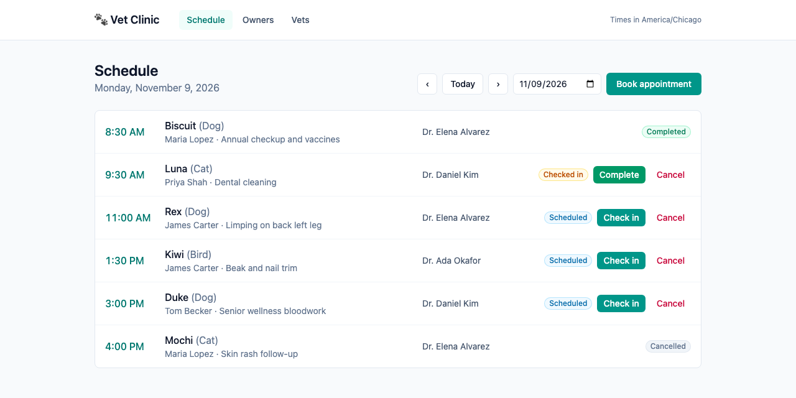

# Vet Clinic

A small veterinary clinic app for managing **owners**, their **pets**, the clinic's **vets** and **appointments**, with a schedule that updates live.

Built with **Elixir/Phoenix + Absinthe (GraphQL)** on the back end and **React + Apollo Client** on the front end. The app is deliberately small; the goal is a polished, well-tested example rather than a sprawling one.



## Features

- **Today's schedule.** Shows the clinic's appointments for the day, in the clinic's own time zone.
- **Live updates.** A GraphQL subscription pushes new bookings and status changes (checked in, completed, cancelled) to every open browser.
- **Booking.** Book, reschedule or reassign an appointment for a pet with a vet. Times in the past and unknown pets or vets are rejected with clear, per-field errors.
- **Visit history.** A pet's appointments filtered by status, e.g. completed visits for history or scheduled ones for what's coming up.
- **Patients and vets.** Owners and their pets, and the vets who see them, with a vet's schedule for any day.
- **Search.** One box in the header finds owners (by name, email or phone number, punctuation optional), pets (by name or species) and vets (by name or email) as you type, with a full results page.
- **Safe deletes.** Deleting an owner or pet archives it instead of erasing it, and cancels their open appointments while keeping completed visits. A vet can't be deleted while they still have appointments.
- **Archive and restore.** Archived owners and pets can still be found ("archived pets", or "Include archived") and opened read-only. Restoring an owner brings back the pets archived with them; cancelled visits stay cancelled.

## Tech stack

| Layer | Tech |
|---|---|
| API | Elixir 1.20, OTP 29, Phoenix 1.8 (API only) |
| GraphQL | Absinthe 1.12, Absinthe.Phoenix (subscriptions over Phoenix Channels), Dataloader |
| Database | PostgreSQL 18 via Ecto |
| Frontend | React 19, TypeScript 7 (strict), Vite 8, Apollo Client 4, React Router 7, Tailwind CSS 4, GraphQL Codegen |
| Back-end quality | ExUnit with Faker, ExCoveralls (90% minimum), Credo (strict), Dialyzer, `mix format`, compile with warnings as errors, `mix hex.audit` |
| Front-end quality | Vitest + Testing Library (90% minimum on lines, statements, functions and branches), Playwright end-to-end tests, oxlint, Prettier, `npm audit` |

## Status

- [x] Postgres setup: local install or Docker Compose
- [x] Phoenix API scaffold with Absinthe dependencies
- [x] Owner, Pet, Vet and Appointment schemas with per-schema contexts behind the `Clinic` API
- [x] Every appointment is booked with a vet
- [x] Full CRUD, with soft delete for owners and pets
- [x] Configurable clinic time zone (`CLINIC_TIME_ZONE`)
- [x] Seed data
- [x] GraphQL schema: queries, mutations, `appointmentChanged` subscription
- [x] ExUnit tests for the domain layer (schemas, contexts, Clinic API)
- [x] ExUnit tests for the GraphQL API over HTTP and the subscription socket
- [x] React + Apollo frontend: live schedule, booking, appointment, owner, pet and vet pages
- [x] Component tests (Vitest) and end-to-end tests (Playwright)
- [x] Search, with archived owners and pets and restoring them
- [ ] Deployment

## GraphQL API

| Endpoint | What |
|---|---|
| `POST /api/graphql` | Queries and mutations |
| `ws://localhost:4000/socket` | Subscriptions (Absinthe over Phoenix Channels) |
| `/api/graphiql` | GraphiQL explorer with the full schema and docs (dev only) |

```graphql
type Query {
  owners: [Owner!]!                       # active owners, by name
  owner(id: ID!, includeArchived: Boolean = false): Owner
  petOwner(petId: ID!): Owner
  pet(id: ID!, includeArchived: Boolean = false): Pet
  ownerPets(ownerId: ID!): [Pet!]!
  vets: [Vet!]!
  vet(id: ID!): Vet
  appointments(date: Date): [Appointment!]!          # clinic schedule; defaults to today in the clinic's time zone
  appointment(id: ID!): Appointment
  vetAppointments(vetId: ID!, date: Date): [Appointment!]!
  petAppointments(petId: ID!, status: AppointmentStatus, includeArchived: Boolean = false): [Appointment!]!
  search(                                 # owners, pets and vets matching term, grouped
    term: String
    archived: Boolean = false             # archived owners and pets only
    includeArchived: Boolean = false      # archived ones alongside active ones
    types: [SearchType!]                  # OWNER, PET, VET; all by default
    limit: Int = 5                        # per group, 1 to 50
  ): SearchResults!                       # { owners pets vets }
}

type Mutation {
  createOwner(input: CreateOwnerInput!): Owner
  updateOwner(id: ID!, input: UpdateOwnerInput!): Owner
  deleteOwner(id: ID!): Owner             # archives the owner and their pets
  restoreOwner(id: ID!): Owner            # and the pets archived with them
  createPet(input: CreatePetInput!): Pet
  updatePet(id: ID!, input: UpdatePetInput!): Pet
  deletePet(id: ID!): Pet                 # archives the pet
  restorePet(id: ID!): Pet                # fails while its owner is archived
  createVet(input: CreateVetInput!): Vet
  updateVet(id: ID!, input: UpdateVetInput!): Vet
  deleteVet(id: ID!): Vet                 # fails while the vet has appointments
  createAppointment(input: CreateAppointmentInput!): Appointment
  updateAppointment(id: ID!, input: UpdateAppointmentInput!): Appointment
  updateAppointmentStatus(id: ID!, status: AppointmentStatus!): Appointment
  deleteAppointment(id: ID!): Appointment
}

type Subscription {
  appointmentChanged: Appointment!        # fires on booking, rescheduling and status changes
}
```

Nested fields such as `owners { pets { appointments { vet { name } } } }` are batched with Dataloader, so they don't cost a query per row.

**Errors.** An unknown or malformed ID returns a `"pet not found"` style error. Invalid input returns one error per field, named the way the API names it:

```json
{
  "data": { "createAppointment": null },
  "errors": [
    {
      "message": "startsAt must be in the future",
      "extensions": { "field": "startsAt" },
      "path": ["createAppointment"]
    }
  ]
}
```

## Frontend

| Route | Page |
|---|---|
| `/` | Daily schedule, kept live: check in, complete or cancel visits. The day is in the URL (`?date=`). |
| `/appointments/new` | Booking: owner, then their pet, vet, time and reason |
| `/appointments/:id` | One visit: status, reschedule or change vet while scheduled, delete |
| `/owners`, `/owners/:id` | Owners and their pets: add, edit, archive; archived owners read-only, with Restore |
| `/pets/:id` | A pet's details and visit history, filtered by status; archived pets read-only, with Restore |
| `/vets`, `/vets/:id` | Vets and a vet's schedule for any day |
| `/search` | All search results, up to 50 per group (`?q=`, `&archived=1` to include archived) |

A few decisions worth calling out:

- **Live updates over Absinthe's channel protocol.** Absinthe runs subscriptions over Phoenix Channels, not `graphql-ws`, and the community Apollo link for it targets Apollo Client 3. So [`absintheLink.ts`](frontend/src/apollo/absintheLink.ts) is a small custom Apollo link on top of the `phoenix` socket, with tests, including unsubscribing when a component unmounts before the server has replied. When `appointmentChanged` fires, the schedule refetches the day it shows.
- **Typed end to end.** `schema.graphql` is exported from the backend and committed, and GraphQL Codegen generates TypeScript types for every query, mutation and fragment from it. Components declare their data as colocated fragments. Renaming a field in the API breaks `tsc`, not the running app, and `npm run check` fails if the generated types are stale.
- **The clinic's time zone, not the browser's.** The API exposes `clinicTimeZone`, and the UI shows and enters times in it, so "today" means the same day on the schedule and in the API wherever the browser is.
- **Search that waits for you.** The header search is an accessible combobox (arrow keys, Enter, Escape) that queries only after typing pauses for half a second. Keywords narrow it: "archived" for archived records, "owners", "pets" or "vets" for one group, so "archived pets" lists archived pets.
- **Cache-first, with clear rules.** Every object is normalized by `id`, so a status change updates every view of that visit. New owners, pets and vets go straight into the cached lists, while lists the server filters (a day's schedule, a pet's history) are refetched.

## Getting started

### Prerequisites

- Elixir 1.20 / OTP 29 and Node 22 (versions pinned in `.tool-versions` for asdf)
- PostgreSQL 18 on port 5432, with a `postgres` / `postgres` superuser. Use either:
  - **A local install**, such as [Postgres.app](https://postgresapp.com) or `brew install postgresql@18`, or
  - **Docker**: `docker compose up -d` starts one for you.

### Run it

```bash
# Only if you're using Docker for Postgres
docker compose up -d

# Install deps, create and migrate the database, load seed data
cd backend
mix setup

# Start the API on http://localhost:4000
mix phx.server
```

In a second terminal:

```bash
# Start the frontend on http://localhost:5173
cd frontend
npm install
npm run dev
```

Open http://localhost:5173 for the app. To see live updates, open the schedule in two windows and check in a visit in one. The API also has a GraphiQL explorer at http://localhost:4000/api/graphiql; try `{ appointments { startsAt reason pet { name } vet { name } } }`.

The seed data puts a busy day of visits on the day you run `mix setup`.

### Configuration

| Env var | Default | Purpose |
|---|---|---|
| `CLINIC_TIME_ZONE` | `America/Chicago` | The clinic's local zone. "Today" and day-based queries use this zone's midnight to midnight; times are stored in UTC. |
| `DB_HOST` | `localhost` | Postgres host (dev and test) |
| `DB_PORT` | `5432` | Postgres port. Docker Compose uses it too, so `DB_PORT=5433` moves both if 5432 is taken. |
| `DB_USER` / `DB_PASSWORD` | `postgres` / `postgres` | Postgres credentials (dev and test) |

Browser origins allowed to call the API (CORS) are set with `config :vet_clinic, :cors_origins` in `config/dev.exs`, which allows the Vite dev server at `http://localhost:5173`.

### Checks

```bash
cd backend
mix precommit         # compile with warnings as errors, hex.audit, format, credo --strict, dialyzer, tests + 90% coverage
mix coveralls.html    # browsable coverage report in cover/excoveralls.html
```

```bash
cd frontend
npm run check         # npm audit, codegen check, tsc, oxlint, prettier, Vitest + 90% coverage
npm run e2e           # Playwright against its own Phoenix (test env) and Vite servers
```

The end-to-end tests run against the test database, never the dev one. Each test runs inside its own database transaction ([Phoenix.Ecto.SQL.Sandbox](https://hexdocs.pm/phoenix_ecto/Phoenix.Ecto.SQL.Sandbox.html)) that's rolled back when it finishes, so they leave no data behind and can run in parallel, even while the dev servers are up.

After changing the GraphQL API, run `npm run schema` then `npm run codegen` in `frontend/` to update the types.

## Project structure

```
vet-clinic/
├── docker-compose.yml        # Optional Postgres 18 on port 5432
├── backend/                  # Phoenix + Absinthe API
│   ├── lib/vet_clinic/       # Business logic: Clinic API, per-schema contexts
│   ├── lib/vet_clinic_web/   # Web layer: endpoint, router, socket
│   │   ├── schema.ex         # Root GraphQL schema
│   │   ├── schema/           # Types, queries and mutations per context; error middleware
│   │   └── resolvers/        # Thin resolvers that call the Clinic API
│   ├── priv/repo/            # Migrations and seeds
│   └── test/                 # Domain tests, plus GraphQL tests over HTTP and the socket
├── frontend/                 # React + Apollo
│   ├── schema.graphql        # API schema, exported from the backend for codegen
│   ├── src/apollo/           # Apollo client and the Absinthe subscription link
│   ├── src/features/         # Pages by area, each with its queries.ts and tests
│   ├── src/components/       # Shared UI: layout, forms, status badge, confirm button
│   ├── src/gql/              # Generated types (not edited by hand)
│   └── e2e/                  # Playwright specs
└── docs/screenshots/
```

## Built with Claude Code

This project was built with [Claude Code](https://claude.com/claude-code), Anthropic's AI coding agent, as a hands-on use of my Claude Code certification. I set the requirements, the architecture and the code style, and reviewed every change. Claude Code did the scaffolding and implementation under that direction.

Some of what that looked like:

- **Project rules in [`CLAUDE.md`](CLAUDE.md).** It holds the Elixir and React conventions, architecture boundaries (no Ecto in the web layer, thin resolvers, Apollo cache rules) and the `mix precommit` and `npm run check` gates every change has to pass. The Elixir style rules a linter can check are enforced by Credo instead of only written down.
- **Plan first.** The plan was written and approved in plan mode before any code was generated.
- **Manual approval.** Every file edit and command was reviewed and approved individually.
- **Attributed commits.** Commits written with Claude carry a `Co-Authored-By` trailer.
